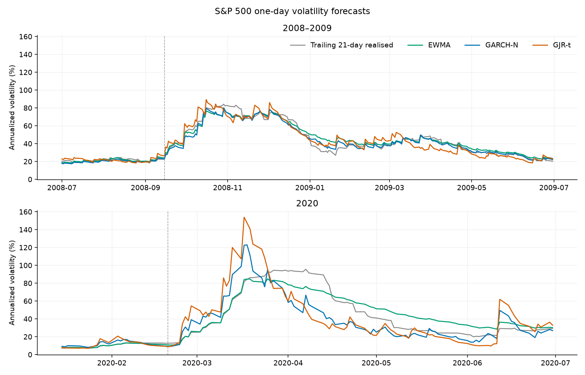
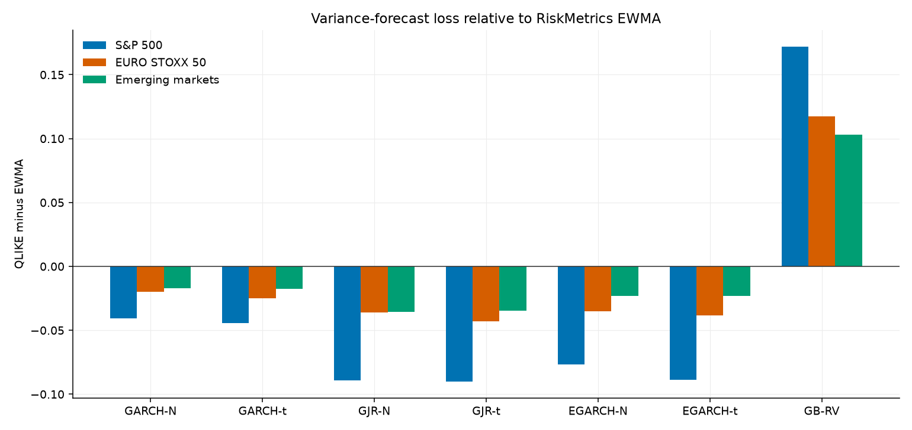
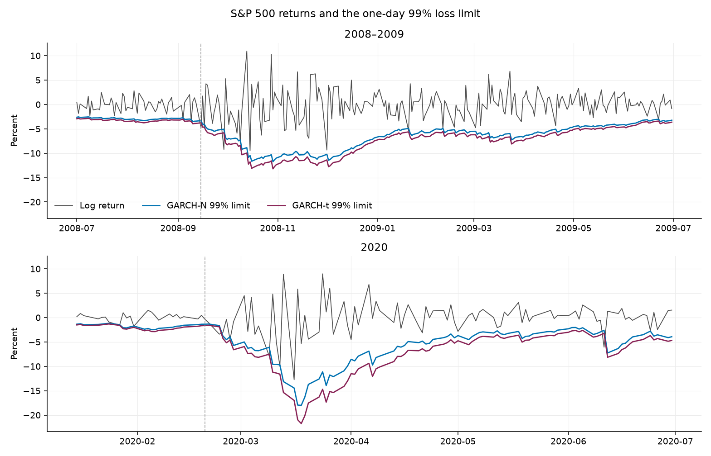
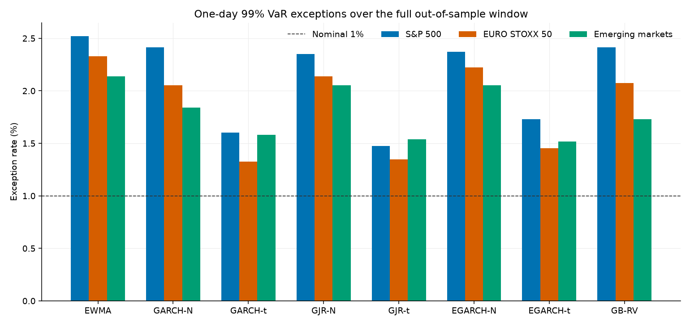

# Volatility forecasts and one-day risk limits

**Santiago Diaz Ricagno, Lead Data Scientist**

A one-day risk limit is a statement about how large tomorrow's loss on an equity book can be. This project compares that statement across eight variance models for three books: the S&P 500, a EURO STOXX 50 tracker, and an emerging-markets tracker. The question is which model gives the most reliable 99% and 97.5% limit, and how much a Student-t tail changes the limit in 2008 and in 2020.

GJR-GARCH(1,1) with Student-t innovations is the model this sample supports. From 18 April 2007 to 17 November 2025 (4,678 sessions on each book) it has the lowest equal-weight QLIKE, **1.348**, against **1.403** for RiskMetrics EWMA and **1.534** for the gradient-boosting baseline. Its 99% exception rates are **1.35%** (EURO STOXX 50), **1.47%** (S&P 500) and **1.54%** (emerging markets). Gaussian limits on the same variance dynamics run at about **2.1–2.5%**. The 250-session review that starts on 1 September 2008 is green for the S&P GJR-t limit (4 exceptions) and yellow for the Gaussian GJR limit (9). The review that starts on 15 February 2020 is yellow for GJR-t (7 S&P exceptions) and red for S&P EWMA (11).

Fat tails barely move the variance score. A Diebold-Mariano test of GJR-t against GJR-normal QLIKE on the S&P has p = 0.91. They do move the limit. In the full sample the Student-t 99% VaR is 6–12% higher than the Gaussian VaR of the same GJR model, and expected shortfall is 12–23% higher. In February–April 2020, with degrees of freedom near 4.3–4.7 on the developed books, the VaR gap widens to 19–25% and the ES gap to 39–50%.

No model passes Kupiec's test at 1% over 4,678 sessions. A 1.5% rate is distinguishable from 1% in a sample this long. The practical gap is still large: the S&P GJR-t limit has 69 exceptions, the S&P GJR-normal limit has 110, and S&P EWMA has 118, against 47 expected.

## Data

Public daily prices are cached in `data/prices.csv` (18,003 rows) so the study runs with no network access.

| Ticker | Series | Cache range |
| --- | --- | --- |
| SPX | S&P 500 index | 2000-01-03 to 2025-11-17 |
| FEZ | EURO STOXX 50 ETF | 2002-10-21 to 2025-11-17 |
| EEM | Emerging-markets ETF | 2003-04-14 to 2025-11-17 |

Open, high, low and close are scaled by that session's adjusted-close ratio, so a split or a dividend is not booked as a loss. The EURO STOXX 50 index history on the public chart endpoint starts in March 2007, which is too short for a four-year estimation window before the 2008 crisis. FEZ is the liquid tracker used in its place. EEM is the emerging-markets tracker.

Stooq's CSV endpoint returned a browser check rather than a file. FRED series `SP500` starts in 2016 and does not cover 2008. The cache comes from the public Yahoo Finance chart endpoint. `data/manifest.json` records the symbols and the adjustment.

If the cache is absent, `simulate_prices` draws a GJR-GARCH(1,1) with unit-variance Student-t shocks and a higher shock scale inside the 2008 and 2020 windows. `python run_backtest.py --synthetic` forces that path. It is an offline fallback. The numbers below are from the cached market sample.

Each series keeps its own sessions. Holiday gaps are not filled.

## Methods

Percent log returns, \(r_t = 100 \log(P_t / P_{t-1})\). The forecast for day \(t\) uses data through \(t-1\) only. The realised-variance proxy is the squared close-to-close return, \(y_t = r_t^2\). That proxy is noisy, and it matches the return the VaR is written on. QLIKE ranks the forecasts because it is robust to that noise (Patton, 2011). MSE is reported beside it.

\[
\mathrm{QLIKE}(f_t, y_t) = \log f_t + \frac{y_t}{f_t},
\qquad
\mathrm{MSE}(f_t, y_t) = (f_t - y_t)^2
\]

with \(f_t = \hat\sigma_t^2\).

**EWMA (RiskMetrics),** \(\lambda = 0.94\):

\[
\hat\sigma_t^2 = \lambda \hat\sigma_{t-1}^2 + (1-\lambda)\, r_{t-1}^2.
\]

**GARCH(1,1):**

\[
\hat\sigma_t^2 = \omega + \alpha r_{t-1}^2 + \beta \hat\sigma_{t-1}^2.
\]

**GJR-GARCH(1,1),** with a leverage term on a negative return:

\[
\hat\sigma_t^2 = \omega + \big(\alpha + \gamma \mathbf{1}_{\{r_{t-1}<0\}}\big) r_{t-1}^2 + \beta \hat\sigma_{t-1}^2.
\]

**EGARCH(1,1),** in the form estimated by `arch`, \(z_t = r_t / \sigma_t\):

\[
\log \hat\sigma_t^2 = \omega + \alpha\big(|z_{t-1}| - \mathbb{E}|z|\big) + \gamma z_{t-1} + \beta \log \hat\sigma_{t-1}^2.
\]

A negative \(\gamma\) raises volatility after a down move.

Innovations are standard normal, or a Student-t standardized to variance one:

\[
\varepsilon = \sqrt{\frac{\nu-2}{\nu}}\, T_\nu.
\]

Parameters are fit on a rolling window of 1,008 sessions, about four years, and refreshed every 21 sessions. Between refreshes the parameters stay fixed and the variance recursion updates every session. The conditional mean is zero. At a one-day 99% horizon the mean is small next to the quantile, and a zero mean makes the Gaussian-versus-t comparison a comparison of scale and tails.

A fit is kept only when every parameter is finite, \(|\omega|,|\alpha|,|\gamma|,|\beta| \le 5\), the degrees of freedom lie in \((2, 500)\), and every variance forecast in the block lies in \((10^{-8},\, 10^{4})\). A warm start that fails those checks is refit from default values. Three EGARCH-t refreshes on the S&P still failed and those sessions were removed for every model, so the horse race stays paired. Four further refreshes did not meet the optimizer's convergence flag and were kept because the variance path passed the bound.

**Gradient-boosting baseline.** Eighty trees of depth 2 and learning rate 0.05 predict \(r_t^2\) from features known at \(t-1\): lagged squared return, absolute return, a down-day flag, 5-, 21- and 63-session mean squared returns, 21-session mean absolute return, 21-session mean squared negative returns, and the EWMA variance. The window and the refresh match the GARCH models. A tree can extrapolate below zero; predictions are clipped to \([0.05,\, 10^{4}]\) percent-squared. The floor sits under the quietest EWMA variance in this sample. VaR for this forecast uses Gaussian quantiles.

**VaR and ES.** The loss on a long book is \(L_t = -r_t\).

\[
\mathrm{VaR}_{\alpha,t} = \hat\sigma_t \, q_\alpha,
\qquad
\mathrm{ES}_{\alpha,t} = \hat\sigma_t \, e_\alpha.
\]

For a normal innovation, \(q_\alpha = \Phi^{-1}(\alpha)\) and \(e_\alpha = \phi(q_\alpha)/(1-\alpha)\). For the unit-variance Student-t, \(q_\alpha\) is \(\sqrt{(\nu-2)/\nu}\) times the ordinary t quantile \(t_\alpha\), and

\[
e_\alpha = \sqrt{\frac{\nu-2}{\nu}} \cdot \frac{f_\nu(t_\alpha)}{1-\alpha} \cdot \frac{\nu + t_\alpha^2}{\nu - 1}.
\]

Levels are 99% and 97.5%. An exception is \(L_t > \mathrm{VaR}_{\alpha,t}\). The shortfall ratio is the average loss on exception days divided by the average ES on those days. A ratio near one means the breach was about the size the ES had advertised.

**Coverage tests.** Kupiec's proportion-of-failures likelihood ratio is \(\chi^2(1)\) against the nominal tail \(1-\alpha\). Christoffersen's independence statistic on the hit sequence is \(\chi^2(1)\). Conditional coverage is the sum, \(\chi^2(2)\).

**Diebold-Mariano.** The loss differential is QLIKE of the named model minus QLIKE of the benchmark. The variance of the mean uses a Newey-West lag \(\lfloor 4 (T/100)^{2/9} \rfloor\), then the Harvey, Leybourne and Newbold adjustment, referred to a t distribution with \(T-1\) degrees of freedom. A negative statistic means the named model has the lower loss.

**Basel zones.** The 1996 market-risk traffic light is the binomial tail of the exception count: green while \(P(X \le k) < 0.95\) under the nominal probability, yellow while that probability is below 0.9999, and red at or above 0.9999. At 99% and 250 sessions this is the familiar 0–4 / 5–9 / 10+ table. The study reports the zone on the full sample, on the last 250 sessions, and on the 250 sessions that begin on 1 September 2008 and on 15 February 2020. Applying the rule to a one-day VaR is an analogue of that backtest, which was written for a 10-day 99% VaR.

**Preference rule for the 99% limit.** Sort by the sum of zone penalties on the two crisis reviews across the three books (green 0, yellow 1, red 2), then by the number of books that fail Kupiec at 5%, then by the mean absolute gap between the hit rate and 1%, then by equal-weight QLIKE. GJR-t and GARCH-t tie on the crisis-zone score (5, because the S&P 2008 review is green and the other five crisis reviews are yellow). GJR-t then wins on calibration (0.45 percentage points from 1%, against 0.50) and on QLIKE.

The scored sample is every session on which all eight models have a finite forecast, from 18 April 2007 to 17 November 2025.

## How to run

```bash
pip install -r requirements.txt
python run_backtest.py
pytest
ruff check src tests run_backtest.py
```

`python run_backtest.py --synthetic` ignores the cache and uses the simulated fallback. The market run completed in **124 seconds** on a 4-core CPU. Tables are written to `results/`, charts to `docs/`.

## Results

Equal-weight means the unweighted average of the three books. QLIKE and MSE are on percent-squared variance. Hit rate and VaR are for the one-day 99% limit. VaR is in percent of the book.

| Model | QLIKE | MSE | 99% hit rate | Mean 99% VaR |
| --- | ---: | ---: | ---: | ---: |
| GJR-t | 1.348 | 77.82 | 1.45% | 3.37 |
| GJR-N | 1.350 | 77.50 | 2.18% | 3.10 |
| EGARCH-t | 1.353 | 80.63 | 1.57% | 3.29 |
| EGARCH-N | 1.359 | 81.32 | 2.21% | 3.02 |
| GARCH-t | 1.375 | 79.41 | 1.50% | 3.42 |
| GARCH-N | 1.378 | 79.12 | 2.10% | 3.12 |
| EWMA | 1.403 | 81.86 | 2.33% | 3.09 |
| GB-RV | 1.534 | 157.20 | 2.07% | 3.35 |

QLIKE by book, same ordering inside each column: GJR-t is first on the S&P (0.879) and on the EURO STOXX 50 book (1.588), and tied with GJR-N on emerging markets (1.576 versus 1.575). GJR-t beats EWMA on QLIKE in every book. Diebold-Mariano statistics are −3.28, −2.61 and −4.03, with p-values 0.001, 0.009 and 0.0001. The boosting model is worse than EWMA in every book (p = 0.006, 0.007, 0.027).

Student-t versus Gaussian QLIKE is small. For the GJR pair the mean loss gaps are −0.0006 (S&P, p = 0.91), −0.0067 (EURO STOXX 50, p = 0.043) and +0.0007 (emerging markets, p = 0.67). Asymmetry, not the innovation family, is what improves the variance forecast. Average degrees of freedom are 7.5 on the S&P, 7.2 on the EURO STOXX 50 book and 12.5 on emerging markets for GJR-t.

### 99% coverage

At a 1% tail, 4,678 sessions imply 46.8 exceptions. Kupiec rejects every model on every book at 5%: the closest call is EURO STOXX 50 GARCH-t at p = 0.033. Independence is a different result. GJR-t independence p-values are 0.38 (S&P), 0.87 (EURO STOXX 50) and 0.92 (emerging markets). Once the variance filter has widened, the next exception is not piled onto the previous one. Conditional coverage still rejects where Kupiec rejects, because the sum of the two statistics is dominated by the hit rate. EURO STOXX 50 GJR-t is the exception, with conditional-coverage p = 0.076.

The 2008 and 2020 columns are exception counts in the 250-session reviews, not in the shorter acute windows further down.

| Book | Model | Exceptions | Hit rate | Kupiec p | Indep. p | Full sample | 2008 review | 2020 review | Shortfall ratio |
| --- | --- | ---: | ---: | ---: | ---: | --- | --- | --- | ---: |
| SPX | GJR-t | 69 | 1.47% | 0.002 | 0.38 | yellow | 4 green | 7 yellow | 1.02 |
| SPX | GARCH-t | 75 | 1.60% | 0.000 | 0.040 | red | 4 green | 6 yellow | 1.00 |
| SPX | EGARCH-t | 81 | 1.73% | 0.000 | 0.63 | red | 9 yellow | 8 yellow | 1.02 |
| SPX | GJR-N | 110 | 2.35% | 0.000 | 0.80 | red | 9 yellow | 8 yellow | 1.10 |
| SPX | GARCH-N | 113 | 2.42% | 0.000 | 0.46 | red | 9 yellow | 10 red | 1.12 |
| SPX | EWMA | 118 | 2.52% | 0.000 | 0.11 | red | 6 yellow | 11 red | 1.17 |
| SPX | GB-RV | 113 | 2.42% | 0.000 | 0.007 | red | 14 red | 13 red | 1.25 |
| FEZ | GARCH-t | 62 | 1.33% | 0.033 | 0.85 | yellow | 6 yellow | 7 yellow | 1.03 |
| FEZ | GJR-t | 63 | 1.35% | 0.024 | 0.87 | yellow | 7 yellow | 7 yellow | 1.01 |
| FEZ | EGARCH-t | 68 | 1.45% | 0.004 | 0.36 | yellow | 8 yellow | 7 yellow | 1.04 |
| FEZ | GARCH-N | 96 | 2.05% | 0.000 | 0.98 | red | 8 yellow | 8 yellow | 1.13 |
| FEZ | GJR-N | 100 | 2.14% | 0.000 | 0.38 | red | 8 yellow | 7 yellow | 1.12 |
| FEZ | EWMA | 109 | 2.33% | 0.000 | 0.72 | red | 6 yellow | 9 yellow | 1.16 |
| FEZ | GB-RV | 97 | 2.07% | 0.000 | 0.068 | red | 16 red | 13 red | 1.26 |
| EEM | EGARCH-t | 71 | 1.52% | 0.001 | 0.42 | yellow | 5 yellow | 8 yellow | 1.04 |
| EEM | GJR-t | 72 | 1.54% | 0.001 | 0.92 | yellow | 5 yellow | 8 yellow | 0.98 |
| EEM | GARCH-t | 74 | 1.58% | 0.000 | 0.87 | red | 5 yellow | 8 yellow | 0.98 |
| EEM | GARCH-N | 86 | 1.84% | 0.000 | 0.30 | red | 5 yellow | 8 yellow | 1.07 |
| EEM | GJR-N | 96 | 2.05% | 0.000 | 0.44 | red | 9 yellow | 9 yellow | 1.04 |
| EEM | EWMA | 100 | 2.14% | 0.000 | 0.57 | red | 6 yellow | 8 yellow | 1.10 |
| EEM | GB-RV | 81 | 1.73% | 0.000 | 0.23 | red | 10 red | 10 red | 1.18 |

The last 250 sessions of the sample, which end on 17 November 2025 and do not contain either crisis, are green for GJR-t on the EURO STOXX 50 and emerging-markets books (3 and 2 exceptions) and yellow on the S&P (5).

Mean 99% ES under GJR-t is 3.44% on the S&P, 4.81% on the EURO STOXX 50 book and 4.38% on emerging markets, against Gaussian GJR ES of 2.82%, 3.92% and 3.90%. Shortfall ratios near 1.00 for the t-models, and 1.10–1.17 for S&P and EURO STOXX 50 Gaussian limits, are the ES version of the same fact: on the days the limit breaks, the Gaussian ES is the number that comes in short.

### 2008 and 2020

The acute windows are 1 September 2008–31 March 2009 (146 sessions) and 15 February 2020–30 April 2020 (52 sessions). Ratios are GJR-t divided by GJR-normal.

| Book | Window | VaR ratio | ES ratio | t hit rate | Gaussian hit rate | Mean \(\nu\) |
| --- | --- | ---: | ---: | ---: | ---: | ---: |
| SPX | Full sample | 1.11 | 1.22 | 1.47% | 2.35% | 7.5 |
| SPX | 2008–09 | 1.13 | 1.23 | 2.05% | 4.11% | 7.9 |
| SPX | Feb–Apr 2020 | 1.19 | 1.39 | 3.85% | 3.85% | 4.7 |
| FEZ | Full sample | 1.11 | 1.23 | 1.35% | 2.14% | 7.2 |
| FEZ | 2008–09 | 1.10 | 1.20 | 2.74% | 3.42% | 7.8 |
| FEZ | Feb–Apr 2020 | 1.25 | 1.50 | 5.77% | 5.77% | 4.3 |
| EEM | Full sample | 1.06 | 1.12 | 1.54% | 2.05% | 12.5 |
| EEM | 2008–09 | 1.10 | 1.16 | 2.74% | 4.79% | 10.6 |
| EEM | Feb–Apr 2020 | 1.07 | 1.14 | 7.69% | 7.69% | 10.3 |

In 2008 the heavier tail cuts the S&P GJR exception rate from 4.1% to 2.1% inside the acute window, and it is what puts the 250-session S&P review on 4 exceptions rather than 9. In spring 2020 the developed-market degrees of freedom fall from about 7.5 to about 4.5, so the 99% limit and especially the ES move further above the Gaussian numbers. The hit rates in that 52-session window match across the t and Gaussian GJR models (2 S&P exceptions, 3 on the EURO STOXX 50 book, 4 on emerging markets) because several of those days were large enough to clear both limits. The t-ES is the figure that still describes the size of the breach. Emerging markets keep degrees of freedom near 10 even in 2020, and the tail uplift stays near 7% for VaR and 14% for ES.

A quiet year looks nothing like either window. In calendar 2017 the S&P GJR-t 99% hit rate is 0.8%, and the other two books are at 0.4% or lower.

### 97.5% limits

Nominal tail 2.5%, so 117 exceptions are expected in 4,678 sessions. GJR-t produces 160 (S&P, 3.42%), 166 (EURO STOXX 50, 3.55%) and 155 (emerging markets, 3.31%). Kupiec rejects all three. The long-sample binomial zone is red on the S&P and the EURO STOXX 50 book and yellow on emerging markets. Gaussian 97.5% rates sit higher, from 3.6% to 4.3% for EWMA. The innovation that pulls a 99% limit toward its nominal rate does not pull a 97.5% limit all the way to 2.5% on this history.

### What to use as a limit

For a one-day 99% limit on these books, use GJR-t, with parameters reviewed about monthly and the variance filter run every session. Quote the historical frequency next to the nominal 99%: here it was about 1.5%, and a 250-session review that includes spring 2020 lands in the yellow zone (7, 7 and 8 exceptions). Use the Student-t ES as the stress number. On the S&P GJR variance that ES was 3.44% on average and about 39% above the Gaussian ES in February–April 2020. Leave the boosted-tree variance out of the limit. It is last on QLIKE and red on both crisis reviews for every book.

The tables behind these figures are `results/vol_scores.csv`, `results/var_tests.csv`, `results/dm_tests.csv`, `results/crisis.csv`, `results/tail_gaps.csv` and `results/limit_ranking.csv`.

## Charts



Trailing 21-day realised volatility against the one-day EWMA, GARCH-normal and GJR-t forecasts, annualized. The dashed lines mark 15 September 2008 and 20 February 2020. In March 2020 the GJR-t one-day forecast jumps ahead of the 21-day trail and ahead of EWMA, which is what a leverage term is for.



QLIKE minus the EWMA loss. Bars below zero are variance forecasts that beat RiskMetrics. The boosting model is the bar above zero.



S&P log returns and the negative of the 99% VaR. The Student-t limit sits below the Gaussian limit through both crises. A handful of sessions clear both.



Full-sample 99% exception rates. The dashed line is the nominal 1%. Student-t models are the cluster nearest that line.

## Tech stack

Python 3.12. numpy 2.5.5, pandas 3.1.1, scipy 1.18.1, arch 9.0.0 (GARCH, GJR-GARCH, EGARCH, normal and Student-t), scikit-learn 1.9.1 (gradient boosting), matplotlib 3.11.2. Tests are pytest 9.2.0. Style is ruff 0.17.5 with a line length of 110. Versions are pinned in `requirements.txt`. The run reads the local cache only.

## Limitations

- The score uses close-to-close squared returns. There is no intraday realised variance. QLIKE is the loss that stays reliable when the proxy is noisy, which is why it, rather than MSE, ranks the models. MSE still prefers GJR, and on some books it prefers the Gaussian GJR slightly over the t version.
- The conditional mean is zero. A mean equation would shift a one-day 99% limit by a few basis points.
- Parameters are refreshed every 21 sessions. The filtered variance moves every session. Three EGARCH-t refreshes on the S&P were dropped, and four others were kept without a clean convergence flag.
- Innovations are symmetric. The leverage effect is in the variance equation. A skewed t would be a further tail adjustment, not a different variance model.
- The boosting model is a small tree on lagged realised volatility, with EWMA included so it has a sane level. It is a baseline, not a search over architectures.
- Three liquid series. FEZ tracks the EURO STOXX 50; it is not the index. EEM is an emerging-markets tracker. Dividend adjustment removes ex-dividend drops and does not reproduce a vendor total-return index.
- Diebold-Mariano p-values are not multiplied by the number of pairs. They describe this comparison.
- Basel colours on a one-day VaR copy the binomial cutoffs of a backtest that was specified for 10-day 99% VaR over 250 sessions. On 4,678 sessions the same rule turns yellow once the hit rate is only modestly above 1%, which is why GJR-t is yellow on the full sample with 69 S&P exceptions.
- The acute 2020 window is 52 sessions. Four exceptions is a 7.7% rate, and the sampling error around that rate is wide.
- The cache stops on 17 November 2025.

## Layout

```
run_backtest.py          market run, or --synthetic
src/volforecast/         data, models, metrics, study, plots
tests/                   pytest
data/prices.csv          cached public sample
data/manifest.json       source and adjustment
results/                 scores, tests, ranking, summary.json
docs/                    four charts
notebooks/risk_limits_briefing.ipynb
```

The license is the MIT license already in `LICENSE`.
